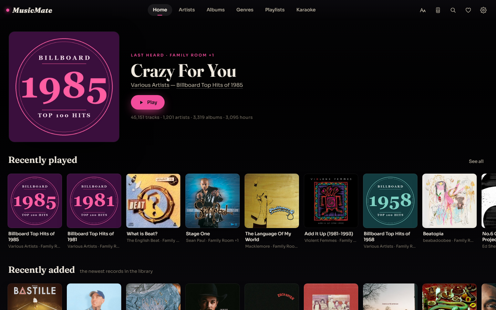
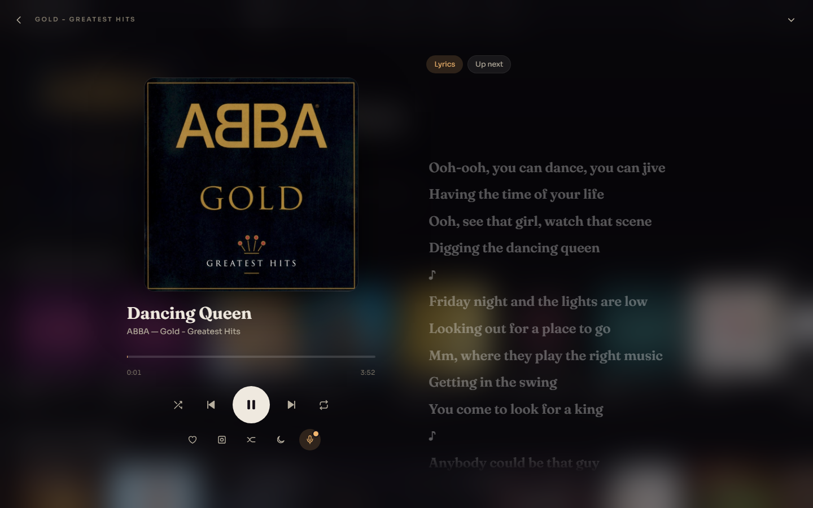
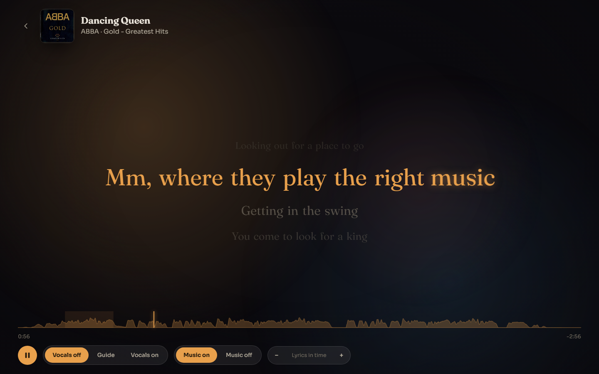
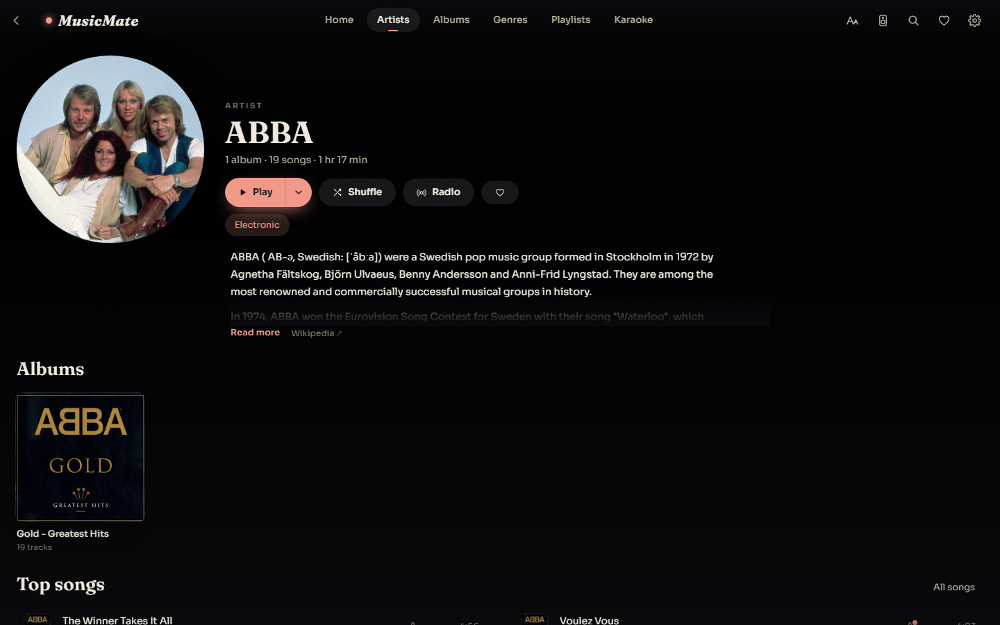
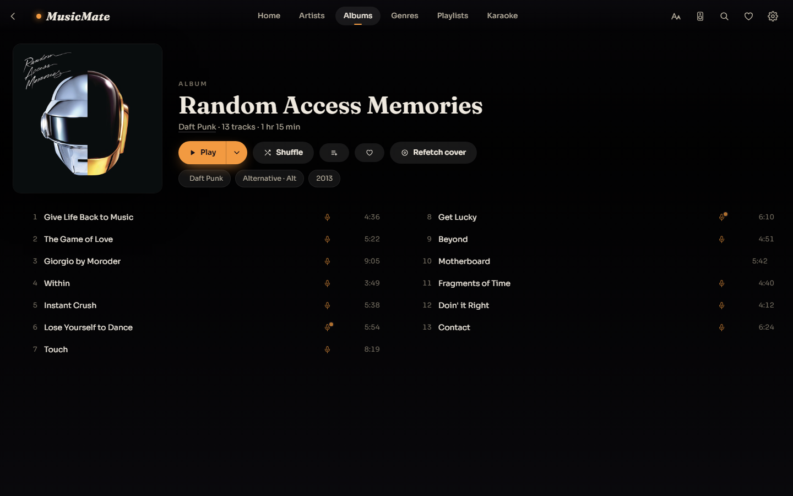
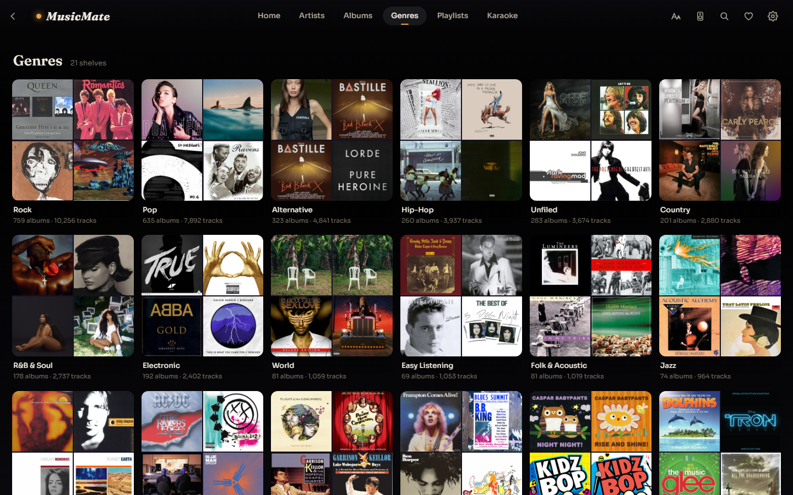
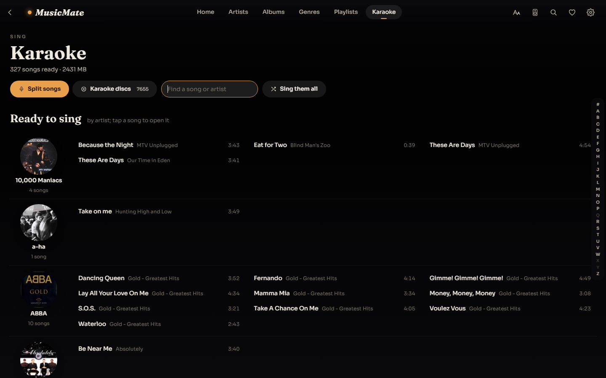
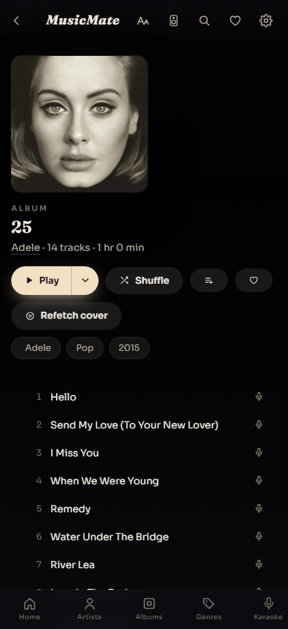

# MusicMate

A home jukebox for a music collection you own. It runs on one PC on your home
network and plays your library on a living-room TV, a phone, a laptop or Sonos
speakers. It also does karaoke: it strips the vocals out of any song in your
library and shows the lyrics word by word as they're sung.

It began as a weekend project to tidy a messy 55,000-track folder of MP3s and
turned into the thing the household actually uses to play music.



## What it does

- **Browse your library like a streaming app.** You get artists with photos
  and biographies, albums with proper cover art, genre shelves, decades,
  playlists, favourites, recently played and recently added. Search covers
  everything.
- **Play anywhere in the house.** Play in the browser you're holding, or send
  the music to a Sonos room. Sonos fetches the audio straight from the server,
  so nothing goes through the cloud and no account is needed.
- **Use it on the TV.** The interface works with a remote's D-pad. A small
  Android TV wrapper app (`tvapp/`) opens it full screen, and it supports
  voice search.
- **See synced lyrics.** Lyrics come from [LRCLIB](https://lrclib.net) and
  scroll in time with the song.
- **Sing karaoke with any song.** [Demucs](https://github.com/facebookresearch/demucs)
  splits a song into vocals and backing. You can sing with the vocals off, at
  guide volume, or on. Each word fills as it's sung, timed by forced alignment
  against the vocal track.
- **Play karaoke discs.** If you have MP3+CD+G karaoke discs, it reads their
  graphics and shows them as clean timed text.
- **Start an artist radio.** It builds a mix from an artist and the artists
  around them.

<table>
<tr>
<td></td>
<td></td>
</tr>
<tr>
<td align="center">Now Playing, with synced lyrics</td>
<td align="center">Karaoke: vocals removed, words fill as they are sung</td>
</tr>
<tr>
<td></td>
<td></td>
</tr>
<tr>
<td align="center">Artist page</td>
<td align="center">Album page (the mic marks songs that can be sung)</td>
</tr>
<tr>
<td></td>
<td></td>
</tr>
<tr>
<td align="center">Genre shelves</td>
<td align="center">Songs ready to sing</td>
</tr>
</table>

On a phone it switches to a bottom tab bar:



## How it fits together

```
your music folder ──► library/musiclib.py scan ──► library/library.db
                                                         │
                                                  jukebox/etl.py
                                                         │
                                                         ▼
 browser / TV / phone ◄──── jukebox/server.py ◄── jukebox/jukebox.db
 Sonos speakers  ◄────────  (FastAPI, port 80)    jukebox/state.db  (your favourites,
                                                                     history, playlists)
```

- `jukebox/` is the app. `server.py` is a FastAPI server, and `ui.html` is
  the whole client in one file with no build step. `sonos.py` drives the
  speakers over local UPnP. `karaoke.py`, `envelope.py` and `align.py` do the
  karaoke work.
- `library/` is the toolchain that scans and tidies a music folder: tag
  repair, duplicate detection with AcoustID fingerprints, cover art fetching
  and MusicBrainz matching. You only need `musiclib.py` to get started. The
  rest are one-job-each scripts written for one particular collection. Most
  default to a dry run and only change files with `--apply`, but not all of
  them do. Read a script before you point it at your music, and back up
  first.
- `tvapp/` is the Android TV wrapper, a single full-screen WebView.

The app never writes to your music. It reads the files and keeps everything
else in its own databases.

## Requirements

- Windows. It's been built and run on Windows 11. Most of the code is plain
  Python and should run elsewhere, but paths and the launcher scripts assume
  Windows.
- Python 3.13
- [ffmpeg](https://ffmpeg.org) on your `PATH`
- A music folder laid out as `Artist/Album/tracks`, with reasonable tags
- Optional, for karaoke: about 1 GB of disk for the vocal-separation model
  and its environment, and a reasonably quick CPU. Separating a four-minute
  song takes about 2½ minutes and keeps every core busy, so songs are
  prepared one at a time in the background.
- Optional: Sonos speakers on the same network

## Getting started

### 0. Lay out your music

MusicMate expects one music folder (`D:\Music` unless you say otherwise)
with your main library inside a subfolder called `VariousArtists`:

```
D:\Music\
  VariousArtists\            <- the main library: Artists, Albums, Genres, Eras
    Daft Punk\
      Random Access Memories\
        01 - Give Life Back to Music.mp3
        ...
  Soundtracks\               <- optional: any other folder becomes its own
  Compilations\                 "library" card on the Home screen
```

To keep your music somewhere else, set `MUSICMATE_ROOT` before running
anything:

```powershell
$env:MUSICMATE_ROOT = 'E:\My Music'                 # this session only
setx MUSICMATE_ROOT "E:\My Music"                   # permanently (new windows)
```

| Setting | Default | What it is |
|---|---|---|
| `MUSICMATE_ROOT` | `D:\Music` | the music folder |
| `JUKEBOX_STEMS` | `D:\MusicStems` (or `~\.jukebox\stems` with no D: drive) | where karaoke separations are kept |
| `JUKEBOX_CDG` | `<music folder>\Karaoke` | MP3+CD+G karaoke discs, if you have any |
| `JUKEBOX_DEMUCS_PY` | `karaoke-venv\Scripts\python.exe` | the Python that runs vocal separation |

### 1. Install

```powershell
git clone https://github.com/craiglindsay/MusicMate.git
cd MusicMate
pip install -r requirements.txt
```

### 2. Index your music

```powershell
python library\musiclib.py scan VariousArtists
python jukebox\etl.py
```

The scan reads the tags from every file into `library/library.db`. `etl.py`
then builds the small, fast database the player runs on. Rerun both whenever
you add music. The scan only rereads files that have changed.

Any other top-level folder you scan, such as `Soundtracks`, shows up as its
own library card on the Home screen:

```powershell
python library\musiclib.py scan VariousArtists Soundtracks Compilations
```

### 3. Run it

```powershell
cd jukebox
python server.py --port 8730
```

It prints its network address. Open that address on any device in the house,
not `localhost`, because the TV and Sonos need an address they can reach.
Use port 80 if you'd like a cleaner URL.

### 4. Optional: karaoke

Vocal separation lives in its own Python environment, so the large machine
learning stack never touches the app:

```powershell
python -m venv karaoke-venv
karaoke-venv\Scripts\python -m pip install --index-url https://download.pytorch.org/whl/cpu torch==2.14.0 torchaudio==2.11.0
karaoke-venv\Scripts\python -m pip install -r requirements-karaoke.txt
```

Restart the server and a microphone icon appears next to songs. Tap it to
prepare a song. The model (about 80 MB) downloads on first use. Separated
tracks are stored outside your music folder, in `D:\MusicStems` by default.
Set `JUKEBOX_STEMS` to choose a different folder.

### 5. Optional: run it all the time

`jukebox/serve.ps1` keeps the server running and restarts it if it stops.
`jukebox/register-task.ps1` registers it as a Windows Scheduled Task that
starts at logon.

### 6. Optional: the TV app

`tvapp/build.ps1` builds the Android TV wrapper into `jukebox/dist/mm.apk`.
The server then offers it at `/mm.apk`, so a TV can install it with the
Downloader app. The server addresses the app tries are listed at the top of
`tvapp/app/src/main/java/com/musicmate/tv/MainActivity.java`. Change them to
your server's address before building.

## Security

**MusicMate has no logins and trusts everyone on your network.** That's fine
for a home LAN. Do not expose it to the internet.

## Some notes on the design

- The TV this was built for runs Chrome 74 from 2019, so `ui.html` avoids
  newer JavaScript and CSS, or provides fallbacks for it. If you change the
  UI and it goes blank on an older device, that's usually why.
- Karaoke animation is driven by real measurements: the vocal envelope, the
  lyric timings and word alignment. Nothing on the karaoke screen moves for
  show.
- `docs/HANDOFF.md` is the long-form working log, kept for anyone continuing
  the work. It explains most "why is it like this?" questions.

## Credits

- Lyrics: [LRCLIB](https://lrclib.net)
- Artist photos and cover art: Deezer, iTunes and the Cover Art Archive
- Artist biographies: Wikipedia
- Metadata: [MusicBrainz](https://musicbrainz.org) and
  [AcoustID](https://acoustid.org)
- Vocal separation: [Demucs](https://github.com/facebookresearch/demucs)
  (Meta AI)

Built with a lot of help from [Claude Code](https://claude.com/claude-code).

## License

MIT. See [LICENSE](LICENSE).
